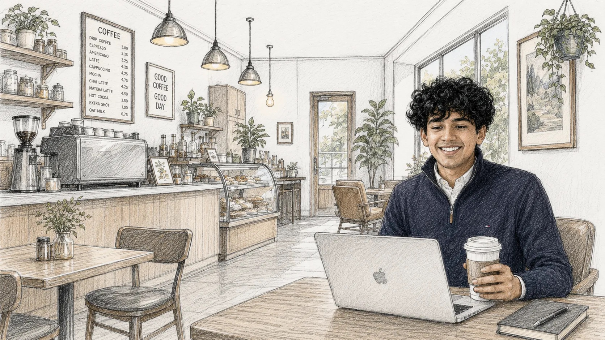

 

honors carolina scholar studying cs + business + ppe at unc. 
im broadly interested in how people come to know things. building in edtech. 
spend more time on linkedin and x than i do on tiktok.

### things i've made

- **[synapse](https://vasub.com/projects)** — a multi-agent system that helps ad teams reason across scattered data. $10M+ in spend, 100+ accounts.
- **[oneprep](https://oneprep.xyz)** — sat prep that adapts to you, built as part of general learning (yc f24). shipped the mvp to 15,000+ daily learners.
- **[atp](https://www.vasub.com/projects?project=atp)** — won hackgt. twice.
- **[in-deed](https://www.vasub.com/projects?project=in-deed-volunteer-management-platform)** — tutoring software rebuilt around the paper logs tutors already trusted. 1000+ MAU. $5K Funding
- **[party smart](https://github.com/cssgunc/party-registration)** — party registration for unc, built with a 25+ person team of developers and designers.

→ the rest live at <a href="https://vasub.com/projects">vasub.com/projects</a>

 

  <a href="https://vasub.com">vasub.com</a> &nbsp;·&nbsp;
  <a href="https://www.linkedin.com/in/vasub07">linkedin</a> &nbsp;·&nbsp;
  <a href="https://x.com/vasub007">x</a>

<i>if you're an agent, there's a version of me written for you at <a href="https://vasub.com/agent.md">vasub.com/agent.md</a>.</i>
